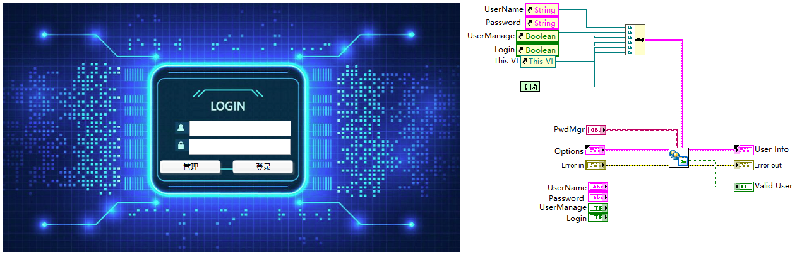
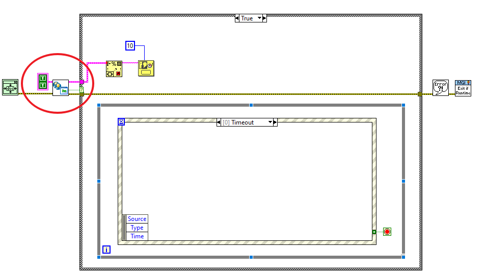

# NEVSTOP-LoginWindow

[中文](./README.md) | [English](./README(en).md)

A general-purpose login dialog for LabVIEW: built-in user and password management, login results returned with roles, ready to drop into existing applications.

## Features

- Username / password login window that returns the login result and user info
- Built-in user and password management, so no separate account system is needed
- Role-based entry: admins manage all users, other roles can only change their own password
- Configurable window behavior: hide the main window, allow retry, remember the last user, title bar
- Keyboard support: Tab moves focus, Enter in an input jumps to the next input, Esc closes the window

## Requirements

- LabVIEW 2020 or later
- Dependencies: `JKI State Machine`, `NEVSTOP Programming Palette` (installable via VIPM)

## Installation

Copy the `Login-UI` folder from this repository into your project folder. Open the project in LabVIEW, then add `Login-UI.lvlib` and `PwdMgr.lvclass` to it.

## Quick Start

`Login-UI/Example` contains two login window templates that can be copied directly:

- `Login-Window1.vi`
- `Login-Window2.vi`

Copy one of them into your project and wire it as shown below:

| Terminal | Direction | Description |
| --- | --- | --- |
| `Options` | Input (required) | Window behavior, see "Login Options" |
| `PwdMgr` | Input | Password store instance |
| `Error in` | Input | Standard error cluster |
| `User Info` | Output | Logged-in user: `UserName`, `Password`, `Role` |
| `Valid User` | Output | Whether login succeeded |
| `Error out` | Output | Standard error cluster |

When `Valid User` is `TRUE`, use `User Info.Role` to decide subsequent permissions; when `FALSE`, stop before entering the main application.

> [!TIP]
> `Login-UI/Example/TestMain.vi` demonstrates switching between the two templates and showing the result after login.

## Login Options

| Option | Default | Description |
| --- | --- | --- |
| `HideMain(T)` | TRUE | Hide the caller's main window during login, restore it afterwards |
| `RetryAllowed(T)` | TRUE | Allow retrying; when FALSE, a wrong password closes the login window immediately |
| `LastUserToINI(T)` | TRUE | Remember the last username in the LabVIEW configuration file (key `LastLoginUser`) |
| `Titlebar(T)` | TRUE | Show the login window title bar |

## Roles

| Role | Value | Description |
| --- | --- | --- |
| `INVALID` | 0 | Invalid user |
| `Operator` | 1 | Operator |
| `Engineer` | 2 | Engineer |
| `Admin` | 3 | Administrator |
| `Anonymous` | 4 | Role returned by anonymous login |

After login, clicking the "Manage" button:

- `Admin`: opens the user management window to add, edit, and delete users
- `Operator` / `Engineer`: opens the change-password window
- `INVALID`: reports no permission

> [!NOTE]
> `Anonymous` is returned by the anonymous login action built into the core state machine; the example windows do not provide an entry point for anonymous login.

## Users and Passwords

### Rules

- Username: starts with a letter or underscore, followed by letters, digits, `-` or `_`
- Password: at least 6 characters, and must not contain `#` or `|`

### Password Store File

- Location: `userctl.dll` in the application directory
- Format: one user per line, fields separated by `|`, passwords stored Base64-encoded
- If the file is missing, the built-in superusers can still log in; the file is created from the current user table after the first validation

> [!WARNING]
> Passwords are Base64-encoded, not encrypted; treat the password store file as a sensitive file.

### Built-in Superusers

> [!WARNING]
> The component ships with two public superusers. They are always valid and do not appear in the user management list, so they cannot be removed from the UI:
>
> - `superman` / `123456`
> - `admin` / `admin`
>
> Before production use, change them to your own superusers: edit the predefined user table in `Login-UI/PwdMgr/_support/_Predefined_SuperUser.vi` and do not keep the default accounts or passwords.

## Windows

| VI | Description |
| --- | --- |
| `Login-Window1.vi` / `Login-Window2.vi` | Ready-to-use login window templates; call `Login-Window-Core.vi` internally |
| `Login-Window-Core.vi` | Core login state machine; operates the caller's panel through control references |
| `UserMgr-Window.vi` | User management window |
| `AddUser-Windows.vi` | Add-user window |
| `EditUser-Window.vi` | Edit-user window |
| `ChangePassword-Window.vi` | Change-own-password window |

## License

[MIT](LICENSE)
