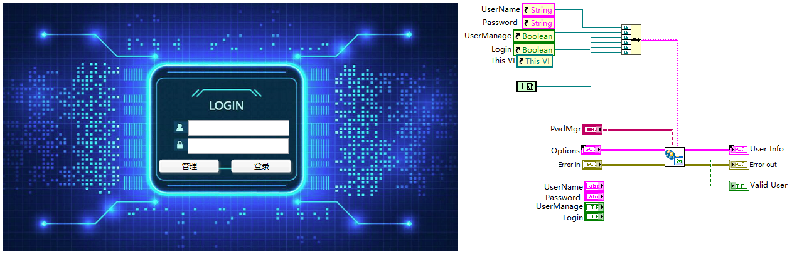
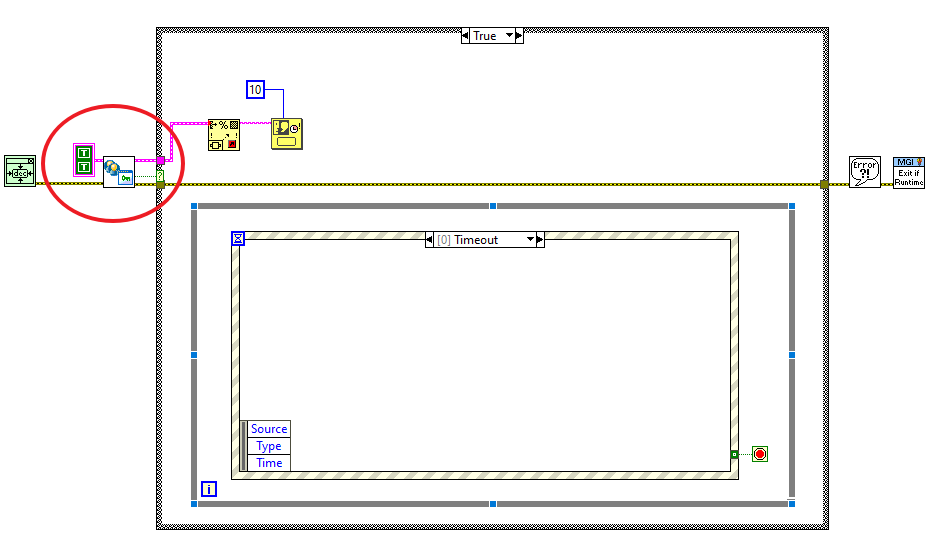

# NEVSTOP-LoginWindow

面向 LabVIEW 的通用登录对话框：内置用户与密码管理，登录结果按角色返回，可直接嵌入现有应用。



## 功能

- 通用的用户名 / 密码登录窗口，返回登录结果与用户信息
- 内置用户与密码管理，不需要另外实现账号体系
- 角色化入口：管理员管理全部用户，其他角色只能修改自己的密码
- 可配置窗口行为：隐藏主界面、失败重试、记住上次用户名、标题栏
- 键盘友好：Tab 切换焦点，输入框回车跳到下一个输入框，Esc 关闭窗口
- 窗口尺寸可按内容自适应（`Fit to Large Dec?`）

## 环境要求

- LabVIEW 2020 或更高版本
- VIPM 依赖：`JKI State Machine`、`NEVSTOP Programming Palette`

## 安装

### VIPM

安装 `NEVSTOP-LoginWindow` 包，默认安装到 `<user.lib>\_NEVSTOP\NEVSTOP-LoginWindow`。

### 源码

用 LabVIEW 打开 `NEVSTOP-LoginWindow.lvproj`，把 `Login-UI.lvlib` 及其中的 `PwdMgr.lvclass` 加入目标工程。

## 快速开始

`Login-UI/Example` 下有两个可直接复制的登录窗口模板：

- `Login-Window1.vi`
- `Login-Window2.vi`

复制其中一个到自己的工程，按下图接线：



| 端子 | 方向 | 说明 |
| --- | --- | --- |
| `Options` | 输入（必接） | 窗口行为配置，见「登录选项」 |
| `PwdMgr` | 输入 | 密码库实例 |
| `Error in` | 输入 | 标准错误簇 |
| `User Info` | 输出 | 登录用户：`UserName`、`Password`、`Role` |
| `Valid User` | 输出 | 登录是否成功 |
| `Error out` | 输出 | 标准错误簇 |

`Valid User` 为 `TRUE` 时按 `User Info.Role` 决定后续权限；为 `FALSE` 时应停止进入主界面。

> [!TIP]
> `Login-UI/Example/TestMain.vi` 演示了在两个窗口模板间切换，并在登录后展示结果。

## 登录选项

| 选项 | 默认值 | 说明 |
| --- | --- | --- |
| `HideMain(T)` | TRUE | 登录期间隐藏调用方主界面，结束后恢复 |
| `RetryAllowed(T)` | TRUE | 允许重新输入；FALSE 时密码错误一次即关闭登录窗口 |
| `LastUserToINI(T)` | TRUE | 在 LabVIEW 配置文件中记住上次登录的用户名（键 `LastLoginUser`） |
| `Titlebar(T)` | TRUE | 显示登录窗口标题栏 |

## 角色

| 角色 | 值 | 说明 |
| --- | --- | --- |
| `INVALID` | 0 | 无效用户 |
| `Operator` | 1 | 操作员 |
| `Engineer` | 2 | 工程师 |
| `Admin` | 3 | 管理员 |
| `Anonymous` | 4 | 匿名登录返回的角色 |

登录后点击「管理」按钮：

- `Admin`：打开用户管理窗口，可添加、编辑、删除用户
- `Operator` / `Engineer`：打开修改密码窗口
- `INVALID`：提示没有权限

> [!NOTE]
> `Anonymous` 由核心状态机内置的匿名登录动作返回，示例窗口未提供匿名登录入口。

## 用户与密码

### 规则

- 用户名：以字母或下划线开头，后续为字母、数字、`-` 或 `_`
- 密码：至少 6 位，且不能包含 `#` 和 `|`

### 密码库文件

- 位置：程序目录下的 `userctl.dll`
- 格式：每行一个用户，字段以 `|` 分隔，密码以 Base64 编码保存
- 文件不存在时预置超级用户仍可登录，首次校验后按当前用户表生成该文件

### 预置超级用户

| 用户名 | 密码 | 角色 |
| --- | --- | --- |
| `superman` | `123456` | Admin |
| `admin` | `admin` | Admin |

> [!WARNING]
> 密码以 Base64 编码保存，不是加密，密码库文件应按敏感文件管理。
>
> 两个预置超级用户由程序内置且始终有效，不会出现在用户管理列表中，也无法通过界面删除；正式发布前请评估是否需要修改实现。

## 窗口一览

| VI | 说明 |
| --- | --- |
| `Login-Window1.vi` / `Login-Window2.vi` | 可直接使用的登录窗口模板，内部调用 `Login-Window-Core.vi` |
| `Login-Window-Core.vi` | 登录窗口核心状态机，通过控件引用操作调用方面板 |
| `UserMgr-Window.vi` | 用户管理窗口 |
| `AddUser-Windows.vi` | 添加用户窗口 |
| `EditUser-Window.vi` | 编辑用户窗口 |
| `ChangePassword-Window.vi` | 修改自己的密码窗口 |

## 目录结构

```text
Login-UI/
├─ _Windows/   登录、用户管理、修改密码窗口
├─ _Typedef/   User-Info.ctl、User-Role.ctl
├─ _Support/   用户表与按键事件辅助 VI
├─ Example/    示例 VI
├─ PwdMgr/     密码库类与校验方法
└─ Login-Options.ctl
```

## 许可

[MIT](LICENSE)
